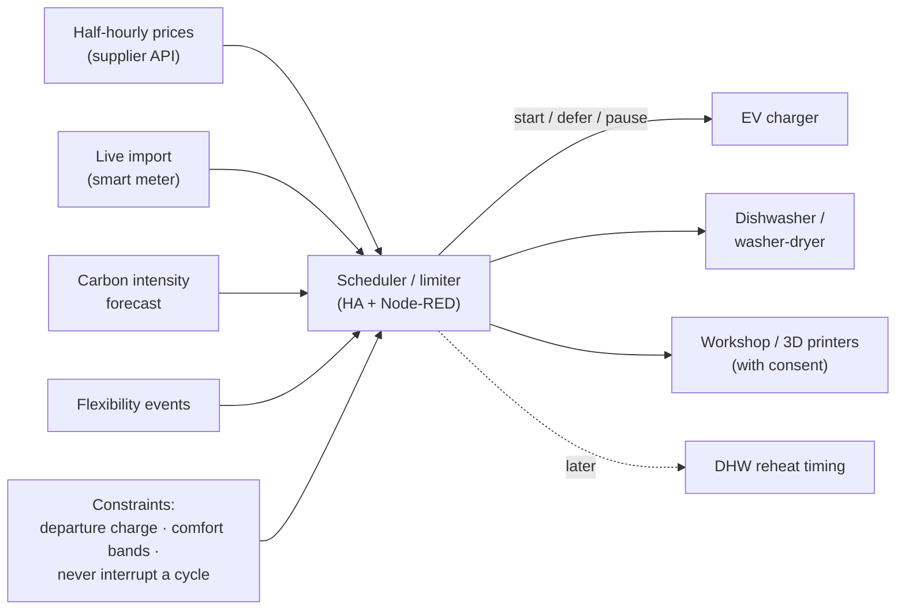

# Demand-Side Energy Management: Tariff-, Carbon- and Peak-Aware Load Control (Design Stage)

**BMS-style energy management for a home: shifting flexible loads (EV charging, appliances, workshop equipment) to cheap or low-carbon periods, limiting peak import demand, and responding to supplier demand-flexibility events, using live tariff, smart-meter and grid carbon-intensity data with comfort and safety constraints that always win.**

> **The short version:**
> - **Signals:** time-of-use tariff prices, live import (smart-meter data), grid carbon intensity, supplier flexibility events.
> - **Flexible loads:** the EV charger (largest), dishwasher/washer-dryer (appliance hub), workshop and 3D printers, and later boiler/DHW timing via the OpenTherm stage.
> - **Strategies:** cheapest/cleanest-window scheduling, **peak-demand limiting** (shed or defer loads above an import threshold), event response.
> - **Constraints:** a car charged by departure time, comfort bands for heating, no interruption of running appliance cycles.

**Portfolio position:** Management level · energy management. Builds on: [energy dashboard](https://github.com/the-control-cabinet/home-energy-dashboard) (metering, tariffs, M&V). Coordinates with: [OpenTherm control](https://github.com/the-control-cabinet/opentherm-boiler-control-esphome) · [supervisory layer](https://github.com/the-control-cabinet/ha-node-red-supervisory-layer)

---

## Status at a glance

| Item | Status |
|---|---|
| Signals, flexible loads and constraints | ✅ Written ([doc 01](docs/01-signals-and-loads.md)) |
| Strategies (cheapest, cleanest, peak limiting, events, fail-safe) | ✅ Written ([doc 02](docs/02-strategies.md)) |
| Measurement and verification method | ✅ Written ([doc 03](docs/03-measurement.md)) |
| Price, import and carbon signals into HA; EV cheapest-window charging; peak limiter (shadow mode) | ⏳ To build |

## Why it matters

Commercial BMS increasingly does energy management, not just comfort: shifting load to cheap or low-carbon periods, capping peak demand, and responding to grid flexibility events. A home with an EV charger, time-of-use tariffs and half-hourly smart-meter data has the same problem at small scale, with the same rule: **flexibility only where comfort and safety allow.**

## How it works

## Flexible loads and their constraints

| Load | Flexibility | Constraint |
|---|---|---|
| EV charger | High: hours | Target charge by departure |
| Dishwasher / washer-dryer | Medium: start delay | Finish by a set time; never interrupt a cycle |
| Workshop / 3D printers | Low: start delay | Operator consent |
| DHW reheat (later) | Medium | Cylinder minimum temperature |

## Strategies

1. **Cheapest window:** each flexible load scheduled into the lowest-price slots that still meet its constraint.
2. **Cleanest window:** the same, ranked by carbon intensity (selectable, or a weighted blend with price).
3. **Peak-demand limiting:** if import exceeds a threshold (e.g. 7 kW) for 2 minutes, reduce or defer loads in priority order (EV first; never heating safety or DHW minimums), restoring with hysteresis.
4. **Event response:** during a supplier event, pause flexible loads and log the delivered reduction.
5. **Fail-safe:** if prices or data are unavailable, every device reverts to its own schedule.

## Measurement and verification

| Metric | Method |
|---|---|
| Cost saved | Actual cost vs the same energy at the average unit price |
| Carbon saved | Energy × intensity vs a flat average |
| Peak import | Monthly maximum half-hour demand, before vs after |
| Event delivery | kWh reduced vs a baseline for each event |

## Design decisions

- **Shadow mode first:** the peak limiter logs what it *would* have shed for a few weeks before it's allowed to act.
- **Constraints are hard, objectives are soft:** a departure deadline or a running wash cycle always beats a cheaper slot.
- **Local fallback:** every device keeps a working schedule of its own, so a lost price feed never leaves the house without hot water or a charged car.

## Documents

| Doc | Contents |
|---|---|
| [01 Signals and loads](docs/01-signals-and-loads.md) | What's measured, what can move |
| [02 Strategies](docs/02-strategies.md) | Scheduling, peak limiting, event response |
| [03 Measurement](docs/03-measurement.md) | Savings and verification |

## Roadmap
- [ ] Signals into HA (prices, import, carbon)
- [ ] EV cheapest-window charging
- [ ] Peak limiter in shadow mode
- [ ] Appliance start-delay scheduling
- [ ] Savings report

## Skills demonstrated (as built)
| Skill | Evidence |
|---|---|
| Energy management | Tariff and carbon-aware scheduling |
| Demand response | Peak limiting and event response |
| Constraint handling | Comfort and safety constraints always win |
| M&V | Cost, carbon and peak savings measured |

📺 [The Control Cabinet on YouTube](https://www.youtube.com/channel/UC5Cupmz7vlfcodpCX7k8iuQ)

*Built and documented by James · part of [The Control Cabinet BMS portfolio](https://github.com/the-control-cabinet/the-control-cabinet). MIT Licence.*
